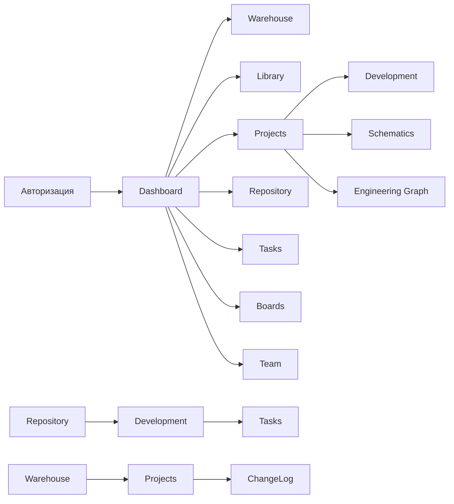

# Архитектура системы

## Назначение

Инженерный портал представляет собой единое веб-приложение, объединяющее процессы разработки электронных устройств, хранения документации, управления компонентами, проектами и задачами.

Основная цель системы — предоставить инженерам единую рабочую среду для выполнения полного цикла разработки изделия.

!!! abstract "Основные возможности"

    Система объединяет:

    - управление складом электронных компонентов;
    - библиотеку инженерной документации;
    - управление проектами;
    - Kanban-доску задач;
    - встроенный репозиторий файлов;
    - рабочее пространство разработки;
    - просмотр схем;
    - управление инженерной архитектурой изделия;
    - командную работу.

---

## Общая структура


> Здесь необходимо вставить экспортированную схему **system-architecture.drawio** в формате SVG.

---

## Основные модули

| Модуль | Назначение |
|---------|------------|
| Dashboard | Главная страница системы |
| Warehouse | Учёт компонентов |
| Library | Хранилище документации |
| Shortage | Контроль дефицита |
| Projects | Управление инженерными проектами |
| Repository | Встроенное файловое хранилище |
| Development | Рабочее пространство разработки |
| CAD Workspace | Создание инженерных схем |
| Tasks | Управление задачами |
| Team | Управление участниками |

---

## Архитектурная схема



---

## Взаимодействие модулей

Каждый функциональный раздел системы работает независимо, однако между разделами реализованы логические связи.

Например:

- карточки компонентов используются в проектах;
- проекты содержат собственные файлы;
- задачи привязываются к проектам;
- изменения автоматически фиксируются в журнале изменений;
- инженерная архитектура связана со схемами и рабочими файлами.

!!! tip "Пример"

    Компонент, созданный в разделе **Warehouse**, может быть использован в спецификации (BOM) одного или нескольких проектов.

---

## Основные сущности системы

```text
Проект
├── BOM
├── Компоненты
├── Документы
├── Архитектура
├── Схемы
├── Репозиторий
├── Development Workspace
└── Задачи
```

---

## Жизненный цикл проекта


---

## Инженерный граф

Каждый проект содержит собственный инженерный граф.

Граф отображает:

- функциональные узлы изделия;
- взаимосвязи между компонентами;
- связанные документы;
- версии файлов;
- журнал изменений.

Подробное описание приведено в разделе **Developer Guide → Engineering Graph**.

---

## Принципы проектирования

!!! note "Особенности реализации"

    Система построена по модульному принципу.

Каждый раздел отвечает за отдельную область инженерной деятельности и может использоваться независимо от остальных модулей.

Это позволяет:

- разделить ответственность между участниками проекта;
- уменьшить количество дублируемой информации;
- централизовать инженерную документацию;
- обеспечить повторное использование компонентов.

---

## Следующий раздел

После знакомства с архитектурой рекомендуется перейти к разделу **Quick Start**, где описан процесс начала работы с системой.