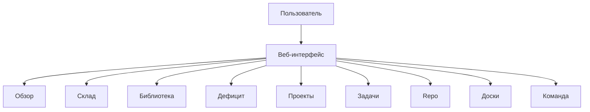

# Архитектура системы

Система представляет собой единое рабочее пространство для управления инженерными данными, проектами, компонентами и задачами.

На функциональном уровне система разделена на несколько взаимосвязанных областей:

- пользовательский интерфейс;
- рабочие разделы системы;
- проекты и связанные с ними данные;
- хранилище файлов и компонентов;
- задачи;
- инженерные доски;
- репозитории;
- API для взаимодействия с системой.

## Общая структура

Пользователь взаимодействует с системой через веб-интерфейс. После авторизации ему доступны основные разделы, объединённые меню **Навигация**.

## Основные компоненты

### Пользовательский интерфейс

Веб-интерфейс является основной точкой взаимодействия пользователя с системой.

Через него пользователь получает доступ к разделам меню **Навигация**, просматривает данные, создаёт и изменяет объекты, работает с проектами и задачами.

### Склад

Раздел **Склад** предназначен для работы с компонентами и связанными с ними инженерными данными.

Компоненты могут использоваться в проектах и связываться с другими объектами системы.

### Библиотека

Раздел **Библиотека** предназначен для хранения и организации файлов и материалов.

Библиотека позволяет централизованно работать с данными, которые используются в проектах.

### Дефицит

Раздел **Дефицит** предназначен для работы с дефицитными компонентами.

### Проекты

Раздел **Проекты** объединяет связанные между собой инженерные данные и материалы проекта.

В рабочем пространстве проекта доступны инструменты для работы с компонентами, схемами, документацией и другими объектами проекта.

### Задачи

Раздел **Задачи** предназначен для создания, организации и управления задачами.

### Repo

Раздел **Repo** предназначен для работы с репозиториями и файлами проекта.

Репозитории могут использоваться для хранения и управления проектными файлами.

### Доски

Раздел **Доски** предназначен для создания и редактирования инженерных чертежей, блок-схем и набросков.

### Команда

Раздел **Команда** предназначен для просмотра состава команды и распределения ролей между участниками.

## Взаимодействие компонентов

Основные рабочие области системы связаны между собой.

Например, проект может использовать компоненты из **Склада**, файлы из **Библиотеки**, задачи из раздела **Задачи** и связанные с проектом файлы из **Repo**.

> Функциональные связи между разделами Склад, Библиотека, Проекты, Repo, Задачи, Доски и Команда.

## Границы документации

В рамках данной документации рассматриваются пользовательские функции системы, основные рабочие процессы и интерфейсы.

Подробная информация о внутренней реализации программных компонентов, серверной инфраструктуре и используемых технологиях не приводится, если она не требуется для выполнения пользовательского сценария.

!!! note "Примечание"

    Диаграммы на этой странице отражают функциональную структуру системы, доступную пользователю. Внутреннее устройство серверной части, базы данных и инфраструктуры в рамках данной документации не рассматривается.

## Следующие шаги

Для знакомства с системой перейдите к разделу [Авторизация](authorization.md) или воспользуйтесь [Быстрым стартом](quick-start.md).

Подробнее о работе с отдельными разделами см. в [Руководстве пользователя](../user-guide/index.md).