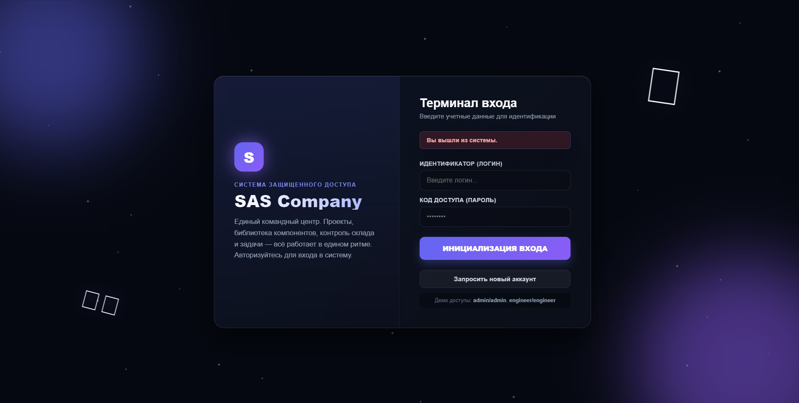

# Авторизация

Для работы с системой необходимо пройти авторизацию.

На странице авторизации доступны:

- поле **Идентификатор (логин)**;
- поле **Код доступа (пароль)**;
- кнопка **Инициализация входа**;
- кнопка **Запросить новый аккаунт**.

> Страница авторизации.

## Инициализация входа

Чтобы выполнить вход в систему:

1. Откройте страницу авторизации.
2. Введите идентификатор в поле **Идентификатор (логин)**.
3. Введите пароль в поле **Код доступа (пароль)**.
4. Нажмите кнопку **Инициализация входа**.

После успешной авторизации откроется главная страница системы — **Обзор**.

## Запрос нового аккаунта

Если у вас еще нет учетной записи, воспользуйтесь кнопкой **Запросить новый аккаунт**.

После нажатия кнопки следуйте дальнейшим инструкциям системы.

## Если не удается пройти авторизацию

Если система не принимает введенные учетные данные:

1. Проверьте правильность идентификатора.
2. Проверьте правильность кода доступа.
3. Повторите попытку авторизации.

Если проблема сохраняется, необходимо обратиться к ответственному сотруднику или администратору системы.

!!! note "Примечание" 

    На странице авторизации отсутствует отдельная кнопка или ссылка для связи с администрацией системы. При возникновении проблем с доступом пользователю может быть непонятно, куда обратиться за помощью.

## Следующие шаги

После успешной авторизации откроется раздел **Обзор**, содержащий основные элементы рабочего пространства.

Подробнее о главной странице см. в разделе [Обзор](overview.md).
