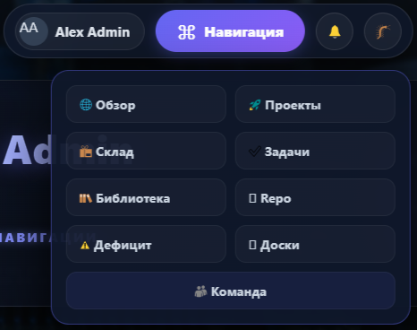

# Быстрый старт

Этот раздел поможет начать работу с системой после авторизации.

В рамках быстрого старта пользователь:

1. проходит авторизацию;
2. открывает раздел **Обзор**;
3. знакомится с основными разделами системы;
4. выбирает необходимую рабочую область;
5. переходит к выполнению рабочих операций.

## Авторизуйтесь в системе

Откройте страницу [Авторизация](authorization.md) и выполните вход с использованием учётных данных.

После успешной авторизации откроется раздел **Обзор**.

## Откройте раздел «Обзор»

Раздел **Обзор** является главной рабочей областью системы.

Здесь отображается презентация компании, доступна информация о текущем пользователе и меню **Навигация** для перехода к другим разделам.

Подробнее о главной странице см. в [Руководстве пользователя — Обзор](../user-guide/dashboard.md).

## Выберите рабочий раздел

После авторизации пользователю доступны следующие разделы:

| Раздел | Назначение |
|---|---|
| Склад | Работа с элементной базой и инженерными данными |
| Библиотека | Хранение и организация файлов и материалов |
| Дефицит | Просмотр информации о дефиците компонентов |
| Проекты | Создание и управление проектами |
| Задачи | Управление задачами и отслеживание их выполнения |
| Repo | Работа с репозиториями и файлами проекта |
| Доски | Создание и редактирование инженерных чертежей |
| Команда | Просмотр состава команды и распределения ролей |

Для перехода к нужному разделу используйте меню **Навигация** в верхней панели.

> Меню «Навигация».

## Следующие шаги

После знакомства с основными разделами перейдите к соответствующему подразделу [Руководства пользователя](../user-guide/index.md).

Для получения дополнительной информации о программном взаимодействии с системой используйте [API Reference](../api-reference/index.md).