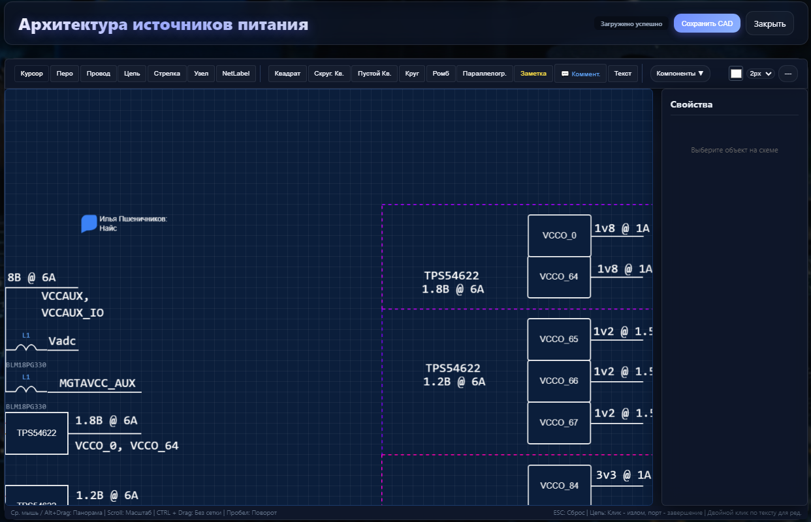

# Доски

Раздел **Доски** предназначен для создания и редактирования чертежей, блок-схем и набросков.

Рабочая область поддерживает создание архитектурных схем, проектирование логики и размещение компонентов в едином графическом пространстве.

## Доски и наброски

После открытия раздела **Доски** отображается страница **Доски и наброски**.

На странице представлены существующие инженерные доски и элементы управления для создания и удаления чертежей.

> **Рисунок 21.** Страница «Доски и наброски».

В верхней части страницы расположены:

- заголовок **Доски и наброски**;
- кнопка **Создать доску**;
- описание назначения раздела;
- счетчик общего количества досок.

Описание раздела:

> Инженерные доски: интерактивные чертежи, блок-схемы и наброски. Создавайте архитектуру модулей, проектируйте логику и сохраняйте идеи.

Количество созданных досок отображается в правой части информационного блока.

## Список досок

Созданные доски отображаются в виде плиток.

Каждая плитка содержит:

- название чертежа;
- имя разработчика;
- дату создания;
- кнопку **Удалить**.

Чтобы открыть чертеж и перейти к его редактированию, нажмите на соответствующую плитку.

!!! warning

    Перед удалением убедитесь, что выбран правильный чертеж. Удаление доски происходит безвозвратно.

## Создание доски

Чтобы создать новый чертеж:

1. Откройте раздел **Доски**.
2. Нажмите **Создать доску**.
3. Создайте новый проектный чертеж.
4. Перейдите в рабочую область редактора.

После создания доска становится доступна в списке **Доски и наброски**.

## Редактор чертежа

После выбора доски открывается рабочая область редактора.

В верхней части редактора отображается название проекта.

Справа от названия расположена информация о состоянии проекта (сохранен или загружен) и доступные кнопки с основными действиями:

- **Сохранить CAD** — сохранить внесенные изменения;
- **Закрыть** — закрыть текущий чертеж.

> **Рисунок 22.** Рабочая область редактора чертежа.

Встроенный САПР объединяет функции графического редактора и инструменты для работы с схемами и компонентами.

## Инструменты редактора

В верхней части рабочей области расположена панель инструментов.

Доступны следующие инструменты:

| Инструмент | Назначение |
|---|---|
| **Курсор** | Выбор и перемещение объектов рабочей области. |
| **Перо** | Создание произвольных линий и набросков. |
| **Провод** | Создание соединений между элементами. |
| **Цепь** | Работа с элементами электрической цепи. |
| **Стрелка** | Создание направленных линий. |
| **Узел** | Добавление узлов на схему. |
| **NetLabel** | Работа с метками электрических соединений. |
| **Квадрат** | Добавление прямоугольного элемента. |
| **Скруг.Кв.** | Добавление скругленного прямоугольника. |
| **Пустой Кв.** | Добавление пустого квадратного элемента. |
| **Круг** | Добавление круглого элемента. |
| **Ромб** | Добавление ромба. |
| **Параллелогр.** | Добавление параллелограмма. |
| **Заметка** | Добавление заметки на рабочую область. |
| **Коммент.** | Добавление комментария. |
| **Текст** | Добавление текстового элемента. |
| **Компоненты** | Выбор и добавление компонентов. |

!!! note

    Кнопка **NetLabel** может быть недоступна для использования в зависимости от текущего состояния редактора.

## Рабочая область

Основную часть редактора занимает графическое поле.

Рабочая область выполнена в виде сетки и предназначена для размещения объектов чертежа.

В рабочей области можно:

- размещать компоненты;
- создавать соединения;
- добавлять геометрические элементы;
- создавать заметки и комментарии;
- добавлять текст;
- создавать произвольные наброски.

Размер и расположение объектов можно изменять непосредственно в рабочей области.

## Компоненты

Для добавления компонента используйте список **Компоненты**.

В списке доступны базовые радиокомпоненты, включая:

- резистор;
- конденсатор;
- катушку;
- диод.

Также в списке могут присутствовать ранее добавленные сложные компоненты, например микросхемы и другие элементы.

Выберите необходимый компонент из списка, чтобы добавить его на рабочую область.

## Свойства компонента

При выборе компонента в правой части редактора отображается информационный столбец **Свойства**.

В нем представлены основные параметры выбранного элемента:

- тип;
- обозначение на чертеже;
- номинал;
- угол поворота.

Параметр поворота позволяет задать ориентацию компонента на чертеже в градусах.

## Цвет и масштаб

Редактор позволяет изменять цвет создаваемых элементов с помощью инструмента выбора цвета.

Для изменения масштаба рабочей области доступны значения:

- **1 px**;
- **2 px**;
- **4 px**.

## Сохранение изменений

После внесения изменений нажмите **Сохранить CAD**.

Информация о последнем сохранении отображается рядом с названием проекта.

Например:

> **Сохранено 15:37**

Перед закрытием чертежа убедитесь, что внесенные изменения сохранены.

## Закрытие чертежа

Чтобы завершить работу с текущим чертежом, нажмите **Закрыть**.

После закрытия пользователь возвращается к предыдущему экрану раздела **Доски**.

!!! warning

    Перед закрытием чертежа сохраните внесенные изменения с помощью кнопки **Сохранить CAD**.

## Типовой сценарий работы

Чтобы создать и отредактировать чертеж:

1. Откройте раздел **Доски**.
2. Нажмите **Создать доску**.
3. Откройте созданный чертеж.
4. Добавьте необходимые компоненты и графические элементы.
5. При необходимости измените свойства выбранных компонентов.
6. Добавьте соединения, текст, заметки и другие элементы.
7. Сохраните изменения с помощью кнопки **Сохранить CAD**.
8. Нажмите **Закрыть**, чтобы завершить работу с чертежом.

## Связь с другими разделами

Инженерные доски являются частью общей рабочей среды системы и могут использоваться совместно с проектными данными.

Для работы с проектами перейдите в раздел [Проекты](projects.md).

Для работы с элементной базой используйте раздел [Склад](warehouse.md).

Для работы с файлами и материалами проекта используйте раздел [Repo](repository.md).
