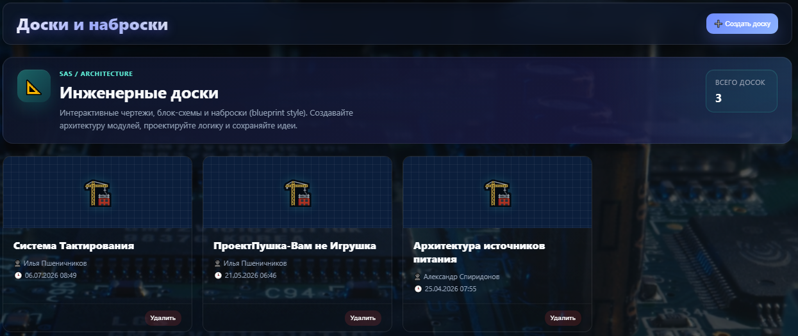

# Доски

Раздел **Доски** предназначен для создания, редактирования и сохранения инженерных чертежей, блок-схем и набросков.

В рабочей области можно создавать архитектурные схемы, проектировать логику модулей, размещать радиокомпоненты, добавлять соединения, заметки и текстовые элементы.

## Доски и наброски

При открытии раздела **Доски** отображается страница **Доски и наброски**.

На странице представлены существующие инженерные доски и инструменты для создания и удаления чертежей.

> Страница «Доски и наброски».

В верхней части страницы расположены:

- заголовок **Доски и наброски**;
- кнопка **Создать доску** — создание нового чертежа;
- описание назначения раздела;
- счётчик общего количества досок.

Описание раздела:

> «Инженерные доски: интерактивные чертежи, блок-схемы и наброски (blueprint style). Создавайте архитектуру модулей, проектируйте логику и сохраняйте идеи.»

Количество созданных досок отображается в информационном блоке рядом с описанием.

## Список досок

Созданные доски отображаются в виде плиток.

Каждая плитка содержит:

- иконку башенного крана;
- название чертежа;
- имя разработчика;
- дату и время создания;
- кнопку **Удалить**.

Для перехода к редактированию нажмите на соответствующую плитку.

### Удаление доски

Для удаления чертежа нажмите **Удалить** на соответствующей плитке.

!!! warning "Внимание"

    Удаление доски выполняется сразу. Перед удалением убедитесь, что выбран правильный чертёж.

## Создание доски

Для создания нового чертежа:

1. Откройте раздел **Доски**.
2. Нажмите **Создать доску**.
3. В открывшемся окне введите название чертежа.
4. Подтвердите создание.

После создания доска становится доступна в списке **Доски и наброски**.

## Редактор чертежа

Для редактирования чертежа нажмите на соответствующую плитку на странице **Доски и наброски**.

> Редактор инженерной доски.

В верхней части редактора отображаются:

- название проекта;
- информация о последнем сохранении изменений;
- кнопка **Сохранить CAD**;
- кнопка **Закрыть**.

### Сохранение изменений

Для сохранения внесённых изменений нажмите **Сохранить CAD**.

Сохранение включает текущий чертёж, свойства компонентов, комментарии и другие внесённые изменения.

Информация о последнем сохранении отображается рядом с названием проекта.

Например:

> «Сохранено 15:37»

### Закрытие редактора

Для завершения работы с чертежом нажмите **Закрыть**.

После закрытия редактора пользователь возвращается на страницу **Доски и наброски**.

Перед закрытием рекомендуется сохранить внесённые изменения.

## Инструменты редактора

В верхней части редактора расположена панель инструментов для создания и редактирования графических объектов.

| Инструмент | Назначение |
|---|---|
| Курсор | Выбор объектов рабочей области |
| Перо | Создание произвольных линий и набросков |
| Провод | Создание соединений между элементами |
| Цепь | Работа с элементами электрической цепи |
| Стрелка | Создание направленных линий |
| Узел | Добавление узлов на схему |
| NetLabel | Инструмент маркировки электрических соединений |
| Квадрат | Добавление квадратного графического элемента |
| Скруг.Кв. | Добавление скруглённого квадрата |
| Пустой Кв. | Добавление пустого квадратного элемента |
| Круг | Добавление круглого элемента |
| Ромб | Добавление ромба |
| Параллелогр. | Добавление параллелограмма |
| Заметка | Добавление заметки на рабочую область |
| Коммент. | Добавление комментария |
| Текст | Добавление текстового элемента |
| Компоненты | Выбор и добавление радиокомпонентов |

!!! note "Примечание"

    Кнопка **NetLabel** отображается в панели инструментов, но в текущем интерфейсе недоступна для использования.

## Рабочая область

Основную часть редактора занимает графическое поле тёмно-синего цвета с сеткой.

Рабочая область предназначена для размещения объектов чертежа, создания схем, заметок и черновых набросков.

В рабочей области можно:

- размещать радиокомпоненты;
- создавать электрические соединения;
- добавлять графические элементы;
- размещать заметки и комментарии;
- добавлять текст;
- создавать произвольные наброски.

## Компоненты

Для добавления радиокомпонентов используйте выпадающий список **Компоненты**.

В списке доступны базовые элементы:

- резистор;
- конденсатор;
- катушка;
- диод.

Также могут присутствовать ранее добавленные сложные объекты, например микросхемы и другие компоненты.

### Размещение компонента

Для размещения компонента на чертеже:

1. Откройте список **Компоненты**.
2. Выберите необходимый элемент.
3. Укажите место размещения компонента курсором в рабочей области.

### Свойства компонента

При выборе компонента в правой части редактора отображается информационная панель **Свойства**.

В панели представлены параметры выбранного элемента:

- **Тип** — тип компонента;
- **Обозначение** — обозначение компонента на чертеже;
- **Номинал** — номинальное значение компонента;
- **Поворот** — угол поворота компонента на чертеже в градусах.

Изменения параметров выполняются непосредственно в панели **Свойства** и применяются без дополнительного подтверждения.

## Цвет и масштаб

В панели инструментов редактора доступен выбор цвета графических элементов.

Для изменения масштаба чертежа предусмотрены значения:

- 1 px;
- 2 px;
- 4 px.

Выбранное значение определяет масштаб отображения чертежа в рабочей области.

## Типовой сценарий работы

Чтобы создать и отредактировать инженерный чертёж:

1. Откройте раздел **Доски**.
2. Нажмите **Создать доску**.
3. Введите название чертежа и подтвердите создание.
4. Откройте созданный чертёж.
5. Выберите необходимые компоненты из списка **Компоненты**.
6. Разместите компоненты на рабочей области.
7. При необходимости измените параметры компонентов в панели **Свойства**.
8. Добавьте соединения, графические элементы, заметки и текст.
9. Настройте масштаб отображения чертежа.
10. Сохраните изменения с помощью кнопки **Сохранить CAD**.
11. Нажмите **Закрыть**, чтобы вернуться на страницу **Доски и наброски**.

## Связанные разделы

- [Проекты](projects.md) — работа с проектами и их документацией.
- [Склад](warehouse.md) — работа с элементной базой и компонентами.
- [Repo](repository.md) — работа с файлами и репозиториями.