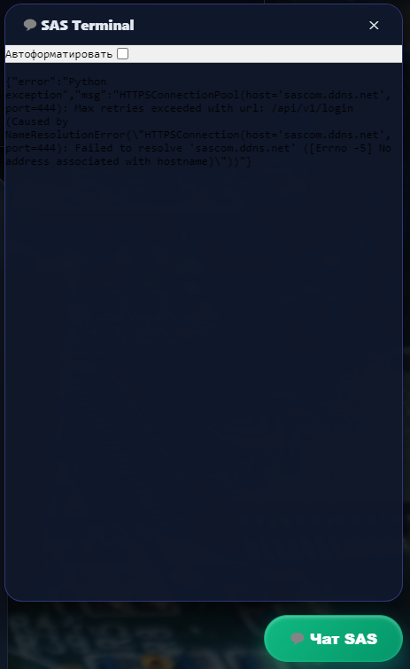

# Обзор

Раздел **Обзор** является главной страницей рабочего пространства и открывается после успешной авторизации.

Страница предназначена для знакомства с системой, отображения информации о текущем пользователе и быстрого доступа к основным функциям.

> Главная страница системы — раздел «Обзор».

## Главная страница

После авторизации пользователь попадает на страницу **Mission Control**.

В верхней части страницы отображается приветствие с именем текущего пользователя, подтверждающее успешный вход в систему.

Ниже расположена информационная подсказка, напоминающая о возможности перехода между разделами через верхнюю панель навигации.

Основную часть страницы занимает главный терминал с видеороликом «Презентация компании». Ролик демонстрирует название компании и предназначен для первоначального знакомства с рабочим пространством.

## Верхняя панель

В верхней части страницы расположена панель управления, содержащая четыре элемента:

- **Аккаунт** — просмотр информации о текущем пользователе и настройка параметров учётной записи;
- **Навигация** — переход между разделами системы;
- **Уведомления** — просмотр поступивших уведомлений;
- **Обратная связь** — отправка сообщения разработчикам или руководству компании.

Панель является динамической: она перемещается вместе с пользователем при прокрутке страницы и остаётся доступной во время работы.

### Аккаунт

Для просмотра информации о текущем пользователе нажмите на иконку аккаунта.

В открывшейся боковой панели отображаются основные сведения об учётной записи:

- логин пользователя;
- пароль, отображаемый в скрытом виде;
- информация о доступе к чату;
- кнопка **Настройки Telegram**;
- кнопка выхода из учётной записи.

Для перехода к настройкам Telegram нажмите **Настройки Telegram**. Система откроет соответствующую страницу.

### Навигация

Для перехода между разделами нажмите **Навигация** на верхней панели.

В открывшемся меню доступны следующие разделы:

- **Обзор** — главная страница с презентацией компании;
- **Склад** — работа с элементной базой и складскими запасами;
- **Библиотека** — работа с библиотекой компонентов;
- **Дефицит** — просмотр информации о дефиците компонентов;
- **Проекты** — управление проектами;
- **Задачи** — работа с задачами;
- **Repo** — управление репозиториями и файлами;
- **Доски** — создание и редактирование инженерных чертежей;
- **Команда** — просмотр состава команды и распределения ролей.

Выберите нужный раздел, чтобы перейти к соответствующей рабочей области.

### Уведомления

Для просмотра уведомлений нажмите на иконку колокольчика.

В открывшемся окне отображаются поступившие уведомления. Для каждого уведомления представлены:

- заголовок;
- начало текста сообщения;
- время поступления.

Если текст уведомления не помещается целиком, отображается его начальная часть.

Для удаления всех уведомлений используйте команду **Очистить всё**.

### Обратная связь

Для отправки сообщения разработчикам или руководству компании нажмите на иконку телефонной трубки на верхней панели.

Откроется форма обратной связи, содержащая следующие обязательные поля:

- **ФИО** — имя отправителя;
- **Контактные данные** — информация для обратной связи;
- **Заголовок сообщения** — тема обращения;
- **Текст сообщения** — описание вопроса, проблемы или предложения.

Заполните все поля и нажмите **Отправить**.

После отправки форма закрывается.

Чтобы закрыть форму без отправки сообщения, нажмите на иконку крестика в правом верхнем углу.

## Чат SAS

В правом нижнем углу страниц системы расположена кнопка **Чат SAS**.

При нажатии открывается встроенное окно чата на базе Rocket.Chat.

Чат предназначен для общения с коллегами по проектам и ведения рабочей переписки.

Для доступа к чату пользователю предоставляются отдельные учётные данные и ссылка на рабочее пространство.

> Окно чата SAS на базе Rocket.Chat.

!!! note "Примечание"

    Интеграция Rocket.Chat с системой находится в процессе доработки. В текущей версии встроенный чат открывается, однако полноценная работа чата внутри системы пока не обеспечена.

## Запрос нового аккаунта

На странице авторизации предусмотрена кнопка **Запросить новый аккаунт**.

При нажатии отправляется запрос администратору на создание учётной записи. Отдельная форма для заполнения данных пользователя не открывается.

## Основное назначение раздела

Раздел **Обзор** выполняет роль стартовой страницы рабочего пространства.

На ней пользователь может:

- ознакомиться с презентацией компании;
- просмотреть информацию о своей учётной записи;
- перейти к нужному разделу через меню **Навигация**;
- просмотреть поступившие уведомления;
- отправить сообщение разработчикам через форму обратной связи;
- открыть чат SAS для общения с коллегами;
- перейти к настройкам Telegram.

Для выполнения конкретных рабочих операций перейдите в соответствующий раздел системы.

## Следующие шаги

- [Склад](warehouse.md) — работа с элементной базой и складскими запасами.
- [Библиотека](library.md) — работа с библиотекой компонентов.
- [Дефицит](deficit.md) — просмотр информации о дефиците компонентов.
- [Проекты](projects.md) — создание и управление проектами.
- [Задачи](tasks.md) — управление задачами и отслеживание их выполнения.
- [Repo](repository.md) — работа с репозиториями.
- [Доски](boards.md) — создание и редактирование инженерных чертежей.