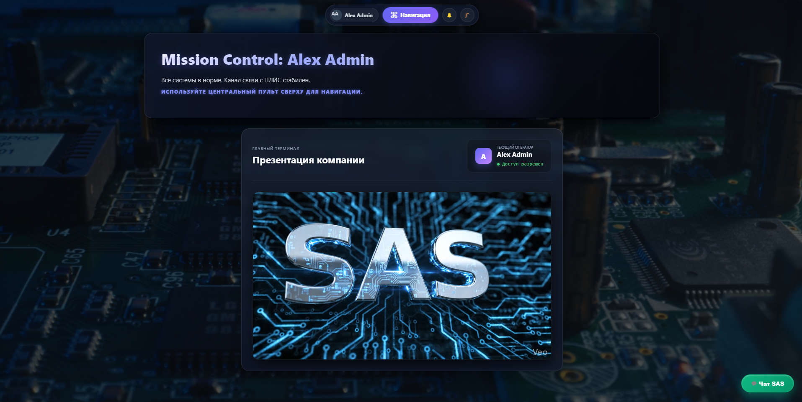

# Обзор

Раздел **Обзор** является главной страницей рабочего пространства и открывается после успешной авторизации.

Страница предназначена для знакомства с системой и быстрого доступа к основным функциям.

> Главная страница системы — раздел «Обзор».

## Навигация

В верхней части страницы расположено меню **Навигация**, которое используется для перехода между основными разделами системы.

Доступны следующие разделы:

- **Обзор**;
- **Склад**;
- **Библиотека**;
- **Дефицит**;
- **Проекты**;
- **Задачи**;
- **Repo**;
- **Доски**;
- **Команда**.

Выберите нужный раздел, чтобы перейти к соответствующей рабочей области.

## Вступительный ролик

В центральной части страницы размещен видеоролик с кратким представлением системы.

Ролик предназначен для первоначального знакомства с возможностями рабочего пространства.

## Чат SAS

На странице доступна кнопка **чата SAS**.

Чат предназначен для взаимодействия с системой и получения дополнительной информации в процессе работы.

!!! note "Примечание" 
    Если чат временно недоступен, это может быть связано с состоянием самого сервиса, а не с ошибкой авторизации пользователя.

## Уведомления

Кнопка с изображением колокольчика используется для просмотра уведомлений.

В уведомлениях отображается информация о новостях и обновлениях системы.

## Обратная связь

Кнопка с изображением змейки предназначена для отправки сообщения разработчикам.

С ее помощью пользователь может сообщить об обнаруженной ошибке или другой проблеме в работе системы.

## Основное назначение раздела

Раздел **Обзор** выполняет роль стартовой страницы рабочего пространства.

На ней пользователь может:

- перейти к нужному разделу через меню **Навигация**;
- ознакомиться с системой с помощью вступительного ролика;
- просмотреть уведомления;
- сообщить разработчикам об обнаруженной проблеме;
- воспользоваться чатом SAS.

Для выполнения конкретных рабочих операций перейдите в соответствующий раздел системы.

## Следующие шаги

Для работы с элементной базой перейдите в раздел [Склад](warehouse.md).

Для работы с файлами и материалами используйте раздел [Библиотека](library.md).

Для создания и управления проектами перейдите в раздел [Проекты](projects.md).

Для работы с задачами используйте раздел [Задачи](tasks.md).
