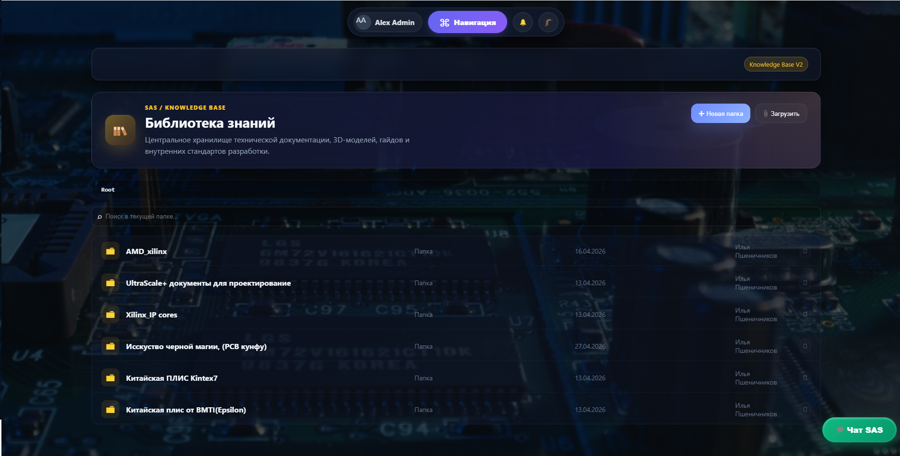

# Библиотека

Раздел **Библиотека** представляет собой централизованное хранилище материалов, используемых в работе с системой. В нём можно хранить техническую документацию, 3D-модели, руководства и внутренние стандарты разработки.

Материалы организованы по папкам. Пользователь может переходить между папками, искать файлы, просматривать их, скачивать и удалять.

> Главная страница раздела «Библиотека».

## Просмотр содержимого папки

На странице раздела отображается содержимое текущей папки.

В верхней части страницы расположены кнопки управления:

- **«Новая папка»** — создание папки в текущем расположении.
- **«Загрузить»** — загрузка файла в текущую папку.

Под кнопками отображается путь к текущему расположению в структуре папок. Он помогает определить, в какой папке находится пользователь.

Чтобы открыть папку, выберите её в списке. Для перехода на уровень выше нажмите кнопку **«Назад»** со стрелкой.

## Поиск файлов

Поиск позволяет находить материалы по ключевым словам в текущей папке и её вложенных папках.

Чтобы найти файл:

1. Откройте раздел **Библиотека**.
2. При необходимости перейдите в папку, в которой предполагается наличие нужного материала.
3. Введите ключевые слова в поисковое поле.
4. Найдите нужный файл в результатах поиска.

Поиск охватывает содержимое текущей папки и вложенных в неё папок.

## Информация о файлах

Для каждого файла в списке отображаются следующие сведения:

- название;
- формат;
- дата загрузки;
- размер.

Справа от информации о файле расположены кнопки действий.

| Кнопка | Назначение |
|---|---|
| Просмотр (значок глаза) | Открытие файла для просмотра непосредственно на сайте |
| Скачать (значок стрелки) | Загрузка файла на компьютер |
| Удалить (значок корзины) | Удаление файла |

### Просмотр файла

Чтобы просмотреть файл:

1. Найдите его в списке.
2. Нажмите кнопку со значком глаза.
3. Просмотрите файл в открывшемся окне на сайте.

### Скачивание файла

Чтобы скачать файл:

1. Найдите нужный файл.
2. Нажмите кнопку со значком стрелки.
3. Дождитесь завершения загрузки.

Файл будет загружен с сайта на компьютер.

## Создание папки

Для организации материалов можно создавать папки внутри текущего расположения.

Чтобы создать папку:

1. Откройте раздел **Библиотека**.
2. Перейдите в папку, в которой требуется создать новую.
3. Нажмите синюю кнопку **«Новая папка»**.
4. В списке появится папка с названием **«Новая папка»**. Её название сразу перейдёт в режим редактирования.
5. Введите нужное название и подтвердите его.

## Загрузка файла

В библиотеку можно загружать файлы размером не более **500 МБ**.

Чтобы добавить материал:

1. Откройте раздел **Библиотека**.
2. Перейдите в папку, в которую необходимо загрузить файл.
3. Нажмите кнопку **«Загрузить»**.
4. Выберите файл для загрузки.
5. Выполните действия, предусмотренные интерфейсом загрузки, чтобы завершить операцию.

Поддерживаются различные типы файлов. Максимальный размер одного файла — 500 МБ.

## Удаление файла

Удаление файла требует подтверждения.

Чтобы удалить файл:

1. Найдите нужный файл в списке.
2. Нажмите кнопку со значком корзины, расположенную справа от кнопок просмотра и скачивания.
3. Подтвердите удаление в появившемся запросе.

Перед подтверждением убедитесь, что выбран правильный файл: удаление приводит к потере материала.

## Удаление папки

Для удаления текущей папки используется красная кнопка **«Удалить эту папку»**, расположенная справа от поискового поля.

Чтобы удалить папку:

1. Перейдите в папку, которую необходимо удалить.
2. Нажмите кнопку **«Удалить эту папку»**.
3. Ознакомьтесь с предупреждением.
4. Подтвердите удаление, если уверены в своём решении.

Если папка не пуста, система предупреждает, что все находящиеся в ней материалы будут безвозвратно удалены вместе с папкой.

!!! note "Важно"

    Перед удалением проверьте содержимое папки. Удаление непустой папки приводит к потере хранящихся в ней материалов.

## Следующие шаги

- [Проекты](projects.md) — работа с проектами и связанными с ними инженерными данными.
- [Склад](warehouse.md) — просмотр и учёт электронных компонентов.