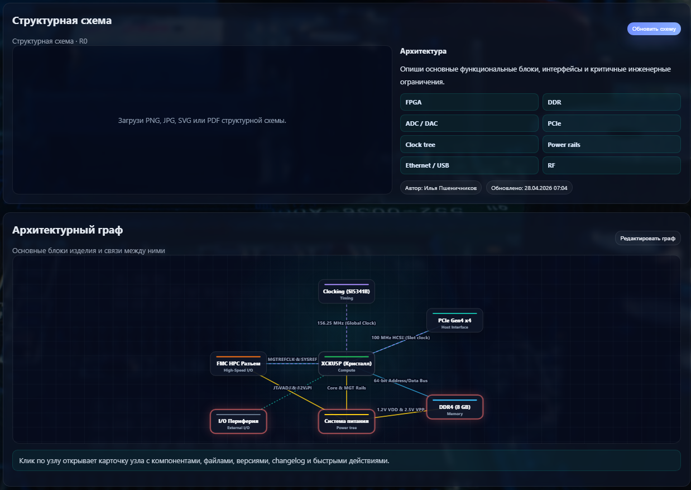
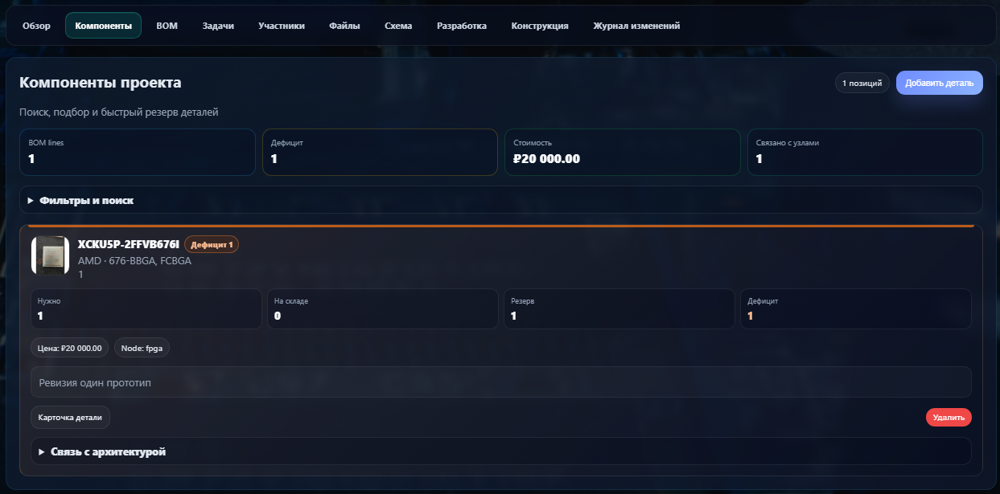
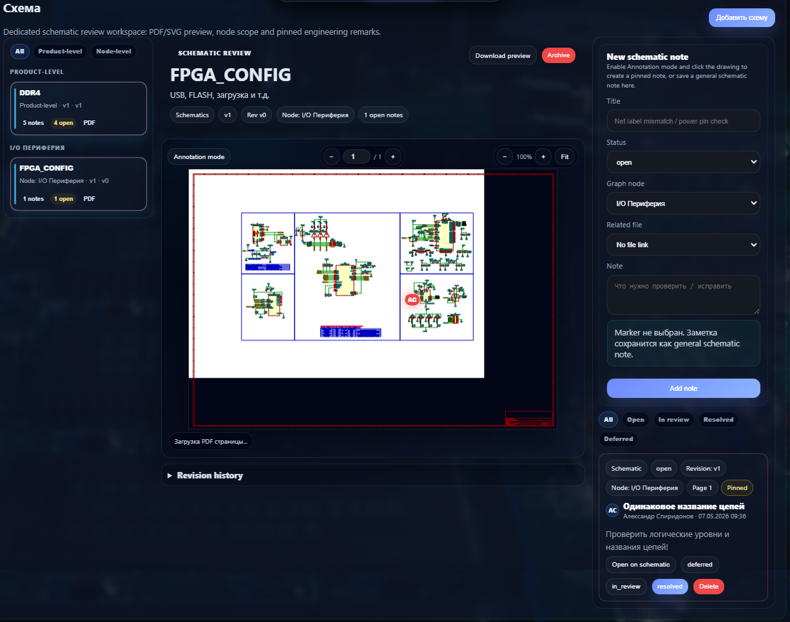
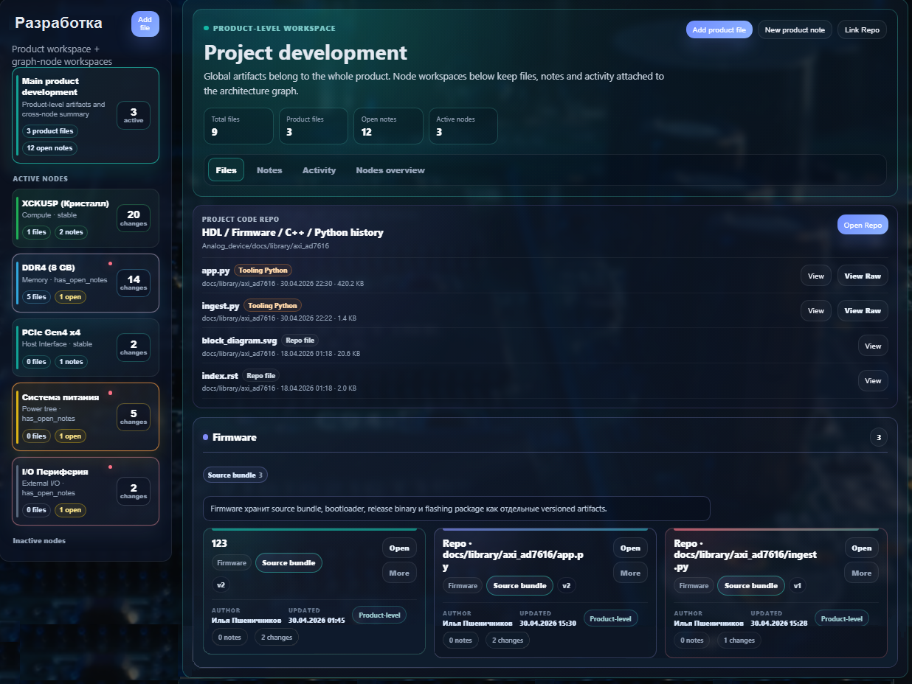

# Проекты

Раздел **Проекты** предназначен для создания и управления инженерными проектами. Он объединяет сведения о проектах, их компонентах, документации, схемах, задачах и материалах разработки.

## Реестр проектов

После открытия раздела **Проекты** отображается реестр доступных проектов.

В верхней части страницы расположена кнопка **Создать проект**, которая запускает процесс создания нового проекта.

Реестр содержит сводную информацию о проектах:

- общее количество проектов;
- количество активных проектов;
- суммарный дефицит компонентов по всем проектам.

Для каждого проекта отображается карточка с основной информацией:

- название и описание;
- статус проекта;
- платформа;
- основной silicon (Primary silicon);
- дата последнего обновления;
- количество позиций BOM;
- количество открытых задач;
- дефицит компонентов.

> Реестр проектов.

### Управление проектами в реестре

Для управления проектами предусмотрены следующие действия:

- **Открыть workspace** — перейти в рабочее пространство проекта.
- **P** — изменить статус проекта на приостановленный (Paused).
- **C** — изменить статус проекта на завершённый (Completed).
- **A** — изменить статус проекта на активный (Active). Кнопка отображается в зависимости от текущего статуса проекта.
- **Del** — удалить проект.

Изменение статуса и удаление выполняются непосредственно после нажатия соответствующей кнопки, без дополнительного подтверждения.

## Рабочее пространство проекта

Чтобы перейти к работе с проектом, выберите его в реестре и нажмите **Открыть workspace**.

Рабочее пространство содержит основные сведения о проекте и набор вкладок для работы с его данными.

> Рабочее пространство проекта.

В верхней части отображаются:

- название и логотип проекта;
- краткое описание;
- текущий статус;
- дата создания;
- дата последнего обновления.

Также доступны сводные показатели:

- **Позиции BOM** — количество позиций в спецификации;
- **Бюджет** — бюджет проекта;
- **Открытые задачи** — количество незавершённых задач;
- **Дефицит** — количество недостающих компонентов.

### Управление проектом

В меню **Управление** доступны следующие действия:

- **Редактировать паспорт проекта** — открыть форму редактирования сведений о проекте;
- **Архивировать** — переместить проект в архив. После архивации он исчезает из основного реестра;
- **Удалить** — удалить проект.

Форма редактирования паспорта позволяет изменять сведения о проекте.

### Вкладки рабочего пространства

Рабочее пространство включает следующие вкладки:

| Вкладка | Назначение |
|---|---|
| Обзор | Сводная информация, характеристики и архитектура проекта |
| Компоненты | Список компонентов, используемых в проекте |
| BOM | Спецификация компонентов проекта |
| Задачи | Задачи, относящиеся к текущему проекту |
| Участники | Список участников проекта |
| Файлы | Документы и файлы проекта |
| Схема | Просмотр схем и работа с инженерными замечаниями |
| Разработка | Рабочее пространство для материалов разработки |
| Конструкция | Отдельная вкладка рабочего пространства |
| Журнал изменений | История событий и изменений проекта |

## Обзор проекта

Вкладка **Обзор** содержит сводную информацию о проекте, его характеристиках и архитектуре.

> Обзор проекта и архитектурный граф.

### Паспорт проекта и характеристики

В обзоре отображаются основные сведения о проекте:

- семейство продукта (Family);
- платформа (Platform);
- основной silicon (Primary silicon);
- теги сценариев использования (Use case);
- сведения о последней проверке паспорта;
- количество файлов разработки.

Отдельный блок содержит ключевые характеристики проекта и их описание.

### Архитектурная диаграмма

В рабочем пространстве предусмотрена возможность загрузки структурной диаграммы проекта. Для этого можно перетащить файл в соответствующую область или выбрать его вручную.

Поддерживаются форматы PNG, PDF и SVG.

После загрузки файла нажмите **Обновить схему**, чтобы обновить отображаемую диаграмму.

### Архитектура проекта

Архитектурный блок содержит описание основных функциональных частей продукта, интерфейсов и инженерных ограничений.

В числе рассматриваемых элементов могут быть:

- FPGA;
- DDR;
- ADC / DAC;
- PCIe;
- Clock tree;
- Power rails;
- Ethernet / USB;
- RF.

Для архитектурного графа предусмотрен просмотр взаимосвязей между компонентами и узлами проекта.

При выборе узла графа открывается карточка с относящимися к нему компонентами, файлами, версиями и историей изменений. В карточке также доступны быстрые действия.

Для редактирования графа предусмотрена кнопка **Редактировать граф**. Она открывает текстовый редактор с исходным кодом графа в формате JSON.

В редакторе доступны действия:

- **Сохранить граф** — сохранить внесённые изменения;
- **Отмена** — отменить редактирование;
- **X** — закрыть редактор.

### Последние архитектурные изменения

В отдельном блоке отображаются последние изменения, связанные с архитектурой проекта. Записи могут содержать тип события, дату и время, а также краткое описание.

Кнопка **В журнал** открывает вкладку **Журнал изменений**.

### Быстрые файлы

Блок **Быстрые файлы** показывает последний загруженный файл проекта.

Кнопка **Все файлы** открывает вкладку **Файлы**.

## Компоненты

Вкладка **Компоненты** предназначена для просмотра компонентов, используемых в проекте.

> Список компонентов проекта.

В верхней части вкладки отображаются сводные показатели:

- количество позиций BOM;
- количество недостающих компонентов;
- стоимость;
- количество компонентов, связанных с узлами архитектурного графа.

Список содержит компоненты, связанные с текущим проектом. Информация о них соответствует сведениям, представленным в разделе **Склад**.

### Поиск компонентов

Для поиска предусмотрен блок **Фильтры и поиск**.

После его открытия можно ввести название компонента и выбрать область поиска: по всем узлам или по определённому компоненту.

Нажмите **Найти**, чтобы выполнить поиск.

## BOM

Вкладка **BOM** содержит спецификацию компонентов проекта (Bill of Materials).

В таблице отображаются сведения о составе и обеспеченности проекта компонентами:

- наименование компонента;
- производитель;
- требуемое количество;
- доступное количество;
- дефицит;
- цена;
- значение Total;
- готовность (Ready), включая индикаторы DS и Files;
- действие **Открыть**.

Вкладка предназначена для просмотра спецификации. Редактирование данных, поиск, фильтрация и сортировка в ней не предусмотрены.

Кнопка **Открыть** переводит пользователя в паспорт соответствующего компонента в разделе [Склад](warehouse.md).

## Задачи

Вкладка **Задачи** содержит задачи, относящиеся к текущему проекту.

Кнопка **Добавить задачу** запускает создание новой задачи. Кнопка **Открыть hub** переводит пользователя в общий раздел управления задачами.

Подробное описание работы с задачами приведено в документе [Задачи](tasks.md).

## Участники

Вкладка **Участники** содержит список пользователей, участвующих в проекте.

Для каждого участника отображаются имя, идентификатор и роль или должность.

### Добавление участника

Чтобы добавить участника:

1. Нажмите **Добавить участника**.
2. В открывшемся списке найдите зарегистрированного пользователя.
3. Выберите нужного пользователя.

За одну операцию можно добавить одного участника.

Добавленных участников можно удалять из списка. Изменение ролей и должностей непосредственно в этой вкладке не предусмотрено.

## Файлы

Вкладка **Файлы** предназначена для просмотра и добавления документов и файлов проекта.

В верхней части вкладки расположены следующие элементы:

- **В Development hub** — переход во вкладку **Разработка**;
- **Добавить документ** — открытие формы загрузки файла.

Загруженные файлы отображаются в виде строк таблицы.

## Схема

Вкладка **Схема** предназначена для просмотра инженерных схем проекта и работы с замечаниями к ним.

Рабочее пространство поддерживает просмотр файлов PDF и SVG, привязку схем к проекту или отдельным узлам архитектурного графа, а также добавление инженерных замечаний.

> Рабочее пространство схем.

### Просмотр схем

В списке схем доступны фильтры:

- **All** — все схемы;
- **Product-level** — схемы уровня продукта;
- **Node-level** — схемы, связанные с отдельными узлами.

Для выбранной схемы отображаются её название, область применения, узел (если схема привязана к узлу), версия, количество замечаний и сведения о файле.

В рабочей области просмотра доступны:

- предварительный просмотр PDF или SVG;
- скачивание файла через **Download preview**;
- архивирование схемы через **Archive**;
- управление масштабом с помощью кнопок увеличения и уменьшения, а также **Fit**;
- просмотр страниц документа.

### Версии схем

Для схем предусмотрена история ревизий. В ней отображаются версии, даты загрузки, авторы и комментарии к изменениям.

Чтобы добавить новую ревизию, используйте форму загрузки. В ней доступны поля:

- файл предварительного просмотра (PDF или SVG);
- исходный файл или архив;
- номер ревизии;
- комментарий.

После заполнения формы нажмите **Upload revision**.

### Инженерные замечания

Для добавления замечания можно включить режим **Annotation mode** и выбрать точку непосредственно на схеме. В этом случае замечание будет привязано к выбранному месту.

Также можно создать общее замечание без привязки к маркеру на схеме.

Форма добавления замечания содержит:

- заголовок;
- статус;
- связанный узел графа;
- связанный файл (при необходимости);
- текст замечания.

Для замечаний предусмотрены статусы:

- **Open** — открыто;
- **In review** — на рассмотрении;
- **Resolved** — решено;
- **Deferred** — отложено.

Добавленные замечания отображаются в списке. Для удобства предусмотрены фильтры по статусам: All, Open, In review, Resolved и Deferred.

В зависимости от статуса и контекста замечания доступны действия по изменению его статуса и удалению. Кнопка **Open on schematic** позволяет перейти к соответствующему месту на схеме.

## Разработка

Вкладка **Разработка** предназначена для работы с файлами, замечаниями и активностью, связанными с разработкой продукта.

> Рабочее пространство разработки.

Рабочее пространство разделено на два уровня:

- **Product-level** — материалы и записи, относящиеся ко всему продукту;
- **Node-level** — рабочие пространства отдельных узлов архитектурного графа.

### Сводная информация

В верхней части вкладки отображаются показатели:

- общее количество файлов;
- количество файлов уровня продукта;
- количество открытых замечаний;
- количество активных узлов.

Также представлен список узлов проекта с краткой информацией о состоянии, количестве файлов, замечаний и изменений.

### Материалы разработки

Для работы с материалами уровня продукта предусмотрены действия:

- **Add product file** — добавить файл продукта;
- **New product note** — создать замечание или запись;
- **Link Repo** — связать проект с репозиторием.

Для просмотра информации предусмотрены вкладки:

- **Files** — файлы;
- **Notes** — замечания и записи;
- **Activity** — активность;
- **Nodes overview** — обзор узлов.

### Репозиторий проекта

В рабочем пространстве может отображаться связанный репозиторий с материалами разработки, включая HDL, Firmware, C++ и Python.

Для перехода к репозиторию предусмотрена кнопка **Open Repo**.

Файлы репозитория могут отображаться с указанием пути, даты обновления, размера и типа. Для некоторых файлов доступны действия **View** и **View Raw**.

### Файлы и артефакты разработки

Рабочее пространство также содержит файлы и артефакты разработки, в том числе версии прошивок и исходные пакеты.

Для отдельных материалов доступны действия просмотра, скачивания последней версии, создания замечания и архивирования.

## Конструкция

В рабочем пространстве проекта предусмотрена отдельная вкладка **Конструкция**.

Дополнительное описание её функций в данной документации не приводится, поскольку достоверные сведения о её содержимом и доступных действиях отсутствуют.

## Журнал изменений

Вкладка **Журнал изменений** содержит хронологическую историю событий проекта.

В журнал могут попадать события, связанные с:

- добавлением и обновлением файлов;
- загрузкой и обновлением схем;
- изменением архитектуры;
- обновлением BOM;
- добавлением и изменением замечаний;
- изменениями прошивок и HDL;
- результатами тестирования и публикацией отчётов;
- изменениями паспорта и характеристик проекта;
- работой с репозиторием.

Записи отображаются в виде последовательности событий. В зависимости от типа события могут быть указаны дата и время, автор, ревизия, связанный узел и краткое описание изменения.

### Фильтрация записей

Для поиска нужных событий предусмотрены фильтры:

- **Тип** — тип события;
- **Graph node** — узел архитектурного графа;
- **Category** — категория события;
- **Author** — автор записи;
- **Revision** — ревизия;
- **Status** — статус.

Кнопка **Фильтр** применяет выбранные параметры. Кнопка **Сбросить** очищает фильтры.

Также предусмотрена кнопка **Добавить запись** для создания новой записи в журнале.

## Работа с проектом

Типовой сценарий работы с проектом:

1. Откройте раздел **Проекты**.
2. Найдите нужный проект в реестре или создайте новый.
3. Откройте рабочее пространство проекта.
4. Просмотрите сведения о проекте на вкладке **Обзор**.
5. При необходимости проверьте состав компонентов и спецификацию BOM.
6. Используйте вкладки **Схема** и **Разработка** для работы с инженерными материалами.
7. Перейдите во вкладку **Задачи**, чтобы просмотреть или добавить задачи проекта.
8. При необходимости просмотрите **Журнал изменений**.

## Связанные разделы

- [Склад](warehouse.md) — просмотр паспортов компонентов и информации об элементной базе.
- [Библиотека](library.md) — работа с файлами и материалами.
- [Задачи](tasks.md) — управление задачами.
- [Repo](repository.md) — работа с файлами проекта в репозитории.