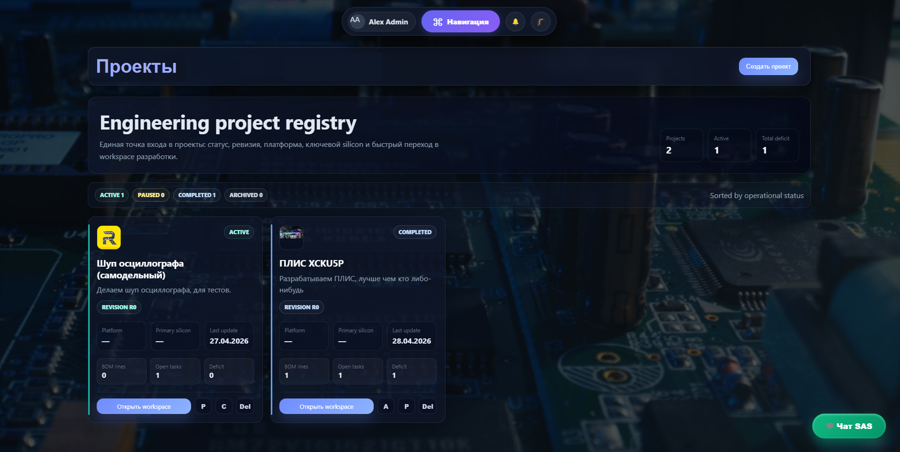
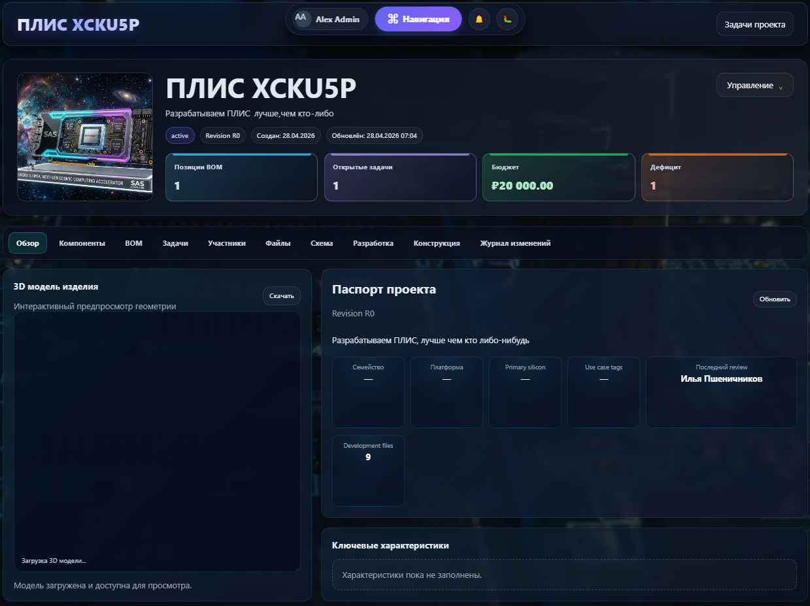
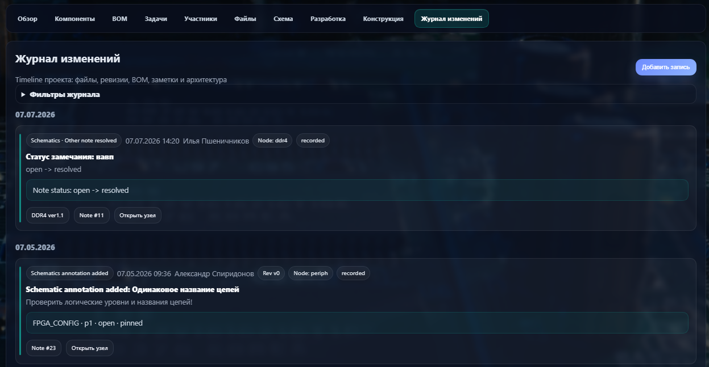

# Проекты

Раздел **Проекты** предназначен для создания и управления инженерными проектами.

Проект объединяет связанные между собой данные и рабочие материалы. В рабочем пространстве проекта доступны инструменты для работы с компонентами, документацией, схемами, графом связей и задачами.

## Реестр проектов

После открытия раздела **Проекты** отображается список доступных проектов.

В реестре можно найти нужный проект и перейти к его рабочему пространству.

> Реестр проектов.

Выберите проект из списка, чтобы открыть его рабочее пространство.

## Рабочее пространство проекта

После открытия проекта пользователь попадает в рабочее пространство, в котором собраны основные данные и инструменты проекта.

> Рабочее пространство проекта.

Рабочее пространство предоставляет доступ к различным представлениям и инструментам проекта.

## Обзор проекта

Вкладка **Обзор** содержит сводную информацию о проекте и связанные с ним материалы.

В зависимости от проекта здесь могут отображаться:

- 3D-представление;
- архитектура;
- паспорт проекта;
- граф связей;
- другая информация, относящаяся к проекту.

> Архитектурный граф.

## Компоненты

Раздел **Компоненты** предназначен для просмотра компонентов, используемых в проекте.

В списке отображаются элементы, связанные с текущим проектом.

> Компоненты проекта.

Информация о компонентах позволяет отслеживать состав элементной базы, используемой в проекте.

## Схема

Раздел **Схема** предназначен для работы со схемой проекта.

Схема позволяет визуально представить связи между элементами и компонентами проекта.

> Схема проекта.

Используйте схему для визуального анализа структуры и взаимосвязей компонентов.

## Разработка

Раздел **Разработка** предназначен для работы с данными, связанными с разработкой проекта.

> Раздел Разработка.

## Журнал изменений

Раздел **Журнал изменений** содержит историю изменений проекта.

> История изменений проекта.

История изменений позволяет отслеживать последовательность внесенных изменений и связанные с ними записи.

## Работа с проектом

Типовой сценарий работы с проектом выглядит следующим образом:

1. Откройте раздел **Проекты**.
2. Найдите необходимый проект в реестре.
3. Откройте рабочее пространство проекта.
4. Используйте соответствующую вкладку для работы с данными проекта.
5. При необходимости просмотрите состав компонентов, схему или историю изменений.

## Связанные разделы

Компоненты проекта могут быть связаны с элементной базой из раздела [Склад](warehouse.md).

Для работы с файлами и материалами проекта используйте раздел [Библиотека](library.md).

Для управления связанными задачами перейдите в раздел [Задачи](tasks.md).

Для работы с файлами проекта в репозитории используйте раздел [Repo](repository.md).
