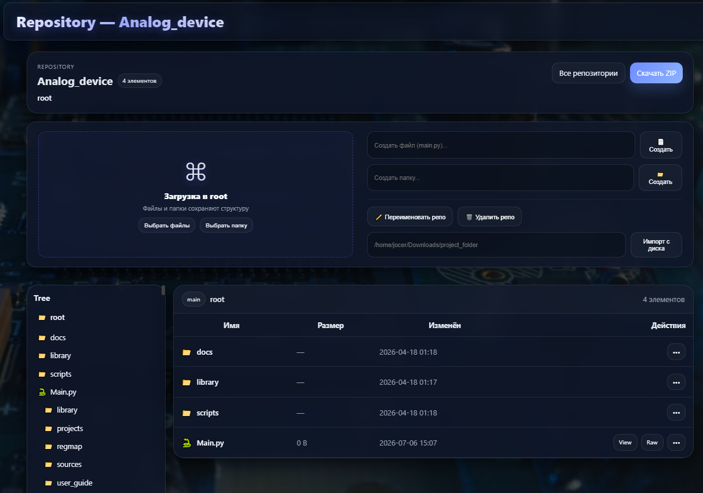

# Repo

Раздел **Repo** предназначен для работы с репозиториями и файлами проекта.

В репозитории можно хранить файлы и папки, просматривать их структуру, добавлять новые объекты, импортировать существующие данные и управлять самим репозиторием.

## Рабочая область репозитория

После открытия репозитория в рабочей области отображается его содержимое.

> **Рисунок 17.** Рабочая область репозитория `Analog_device`.

В левой части отображается дерево репозитория. В нем представлены каталоги и файлы, содержащиеся в текущем репозитории.

Выберите файл или папку в дереве, чтобы перейти к работе с соответствующим объектом.

## Навигация по репозиториям

Для возврата к списку доступных репозиториев используйте кнопку **Все репозитории**.

## Скачать репозиторий

Чтобы сохранить содержимое репозитория на компьютер, нажмите **Скачать ZIP**.

Система сформирует архив с текущим содержимым репозитория.

## Создание файла

Новый файл можно создать непосредственно в текущем репозитории.

Чтобы создать файл:

1. Введите имя файла.
2. Нажмите кнопку **Создать**.
3. Подтвердите создание.

После этого новый файл появится в дереве репозитория.

## Создание папки

Папку можно создать непосредственно в текущем репозитории.

Чтобы создать папку:

1. Введите название папки.
2. Нажмите кнопку **Создать**.
3. Подтвердите создание.

Созданная папка появится в структуре репозитория.

## Импорт файлов и папок

Существующие файлы и папки можно добавить в репозиторий с компьютера.

### Импорт с диска

Чтобы импортировать данные с компьютера:

1. Нажмите **Импорт с диска**.
2. Укажите путь к файлу или папке на компьютере.
3. Подтвердите импорт.

Выбранные данные будут добавлены в репозиторий.

### Перетаскивание файлов

Для добавления данных также можно использовать механизм **Drag and Drop**.

Перетащите файл или папку с компьютера в область репозитория.

Система добавит выбранные данные в текущий репозиторий.

## Управление репозиторием

В интерфейсе доступны операции управления текущим репозиторием.

### Переименование репозитория

Чтобы изменить название репозитория, используйте кнопку **Переименовать репо**.

Введите новое название и подтвердите операцию.

### Удаление репозитория

Чтобы удалить текущий репозиторий, используйте кнопку **Удалить репо**.

Перед удалением убедитесь, что репозиторий больше не требуется.

!!! warning

    Удаление репозитория является операцией, изменяющей данные. Перед выполнением убедитесь, что выбран правильный репозиторий.

## Структура репозитория

Репозиторий представлен в виде иерархического дерева.

В дереве могут находиться:

- файлы;
- папки;
- вложенные папки;
- другие объекты, входящие в состав репозитория.

Иерархическая структура позволяет организовать файлы по каталогам и быстро находить необходимые данные.

## Следующие шаги

Для работы с проектами перейдите в раздел [Проекты](projects.md).

Для работы с задачами используйте раздел [Задачи](tasks.md).

Для хранения и организации дополнительных материалов используйте раздел [Библиотека](library.md).
