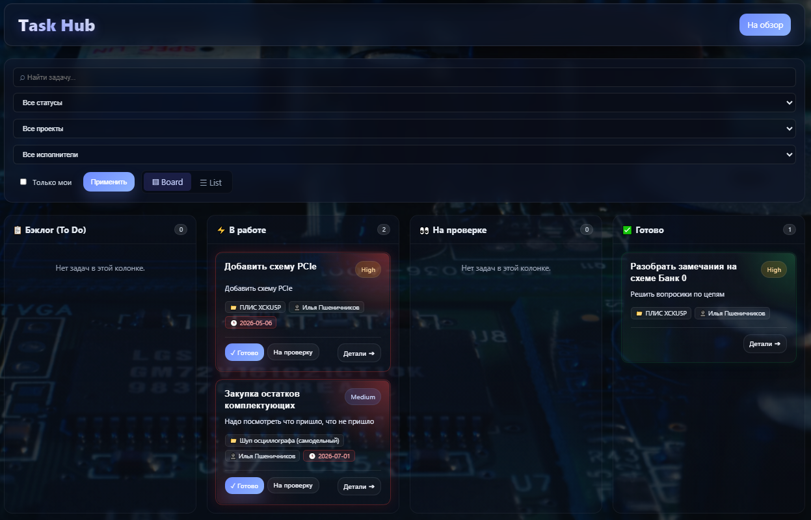

# Задачи

Раздел **Задачи** открывает рабочую область **Task Hub**, предназначенную для поиска, просмотра и управления рабочими задачами.

В Task Hub доступны два представления:

- **Board** — Kanban-доска, на которой задачи сгруппированы по этапам рабочего процесса;
- **List** — список задач с основной информацией.

По умолчанию открывается представление **Board**.

## Поиск и фильтрация задач

В Task Hub доступны строка поиска и фильтры, которые позволяют найти задачи по ключевым словам и заданным параметрам.

Для поиска введите название задачи или ключевые слова в строку поиска.

Для дополнительной фильтрации используйте выпадающие списки:

- **Статус** — фильтрация по этапу рабочего процесса: к выполнению, в работе, на проверке или готово;
- **Проект** — выбор проекта, к которому относится задача;
- **Исполнитель** — выбор пользователя, которому назначена задача.

Чтобы отображать только задачи, назначенные текущему пользователю, установите флажок **Только мои**.

После выбора параметров нажмите **Применить**.

Фильтры можно использовать совместно, чтобы сузить результаты поиска.

## Представление Board

В представлении **Board** задачи отображаются на Kanban-доске и распределяются по четырём колонкам:

- **Бэклог (To Do)** — задачи, ожидающие выполнения;
- **В работе** — задачи, над которыми ведётся работа;
- **На проверке** — задачи, ожидающие проверки;
- **Готово** — завершённые задачи.

> Представление Board в Task Hub.

Карточка задачи содержит краткую информацию:

- название задачи;
- описание;
- проект;
- исполнитель;
- срок выполнения;
- приоритет задачи.

Приоритет обозначается цветовым индикатором:

- **High** — красный;
- **Medium** — жёлтый;
- **Low** — зелёный.

Для изменения состояния задачи доступны кнопки:

- **Готово** — переводит задачу в колонку «Готово»;
- **На проверку** — переводит задачу в колонку «На проверке»;
- **Детали** — открывает подробное представление задачи.

Чтобы просмотреть полную информацию о задаче или изменить её параметры, нажмите **Детали**.

## Представление List

В представлении **List** задачи отображаются в виде списка.

> Представление List в Task Hub.

Для каждой задачи отображаются:

- название;
- проект;
- приоритет;
- исполнитель;
- статус;
- срок выполнения.

Справа от информации о задаче расположены элементы управления:

- **Чекбокс с галочкой** — переводит задачу в статус «Готово» после нажатия;
- **Открыть** — открывает подробное представление задачи.

Для поиска и фильтрации задач в представлении List используются те же строка поиска, выпадающие списки и флажок **Только мои**, что и в представлении Board.

## Подробное представление задачи

Чтобы открыть подробную информацию о задаче, нажмите **Детали** в представлении Board или **Открыть** в представлении List.

> Подробное представление задачи.

В подробном представлении отображаются основные параметры задачи:

- название;
- описание;
- проект;
- исполнитель;
- статус;
- приоритет;
- срок выполнения;
- плановое время выполнения в часах;
- фактически затраченное время в часах.

В нижней части представления доступны быстрые действия:

- **Выполнено** — переводит задачу в статус «Готово»;
- **На проверку** — переводит задачу в статус «На проверке».

### Редактирование задачи

Чтобы изменить параметры задачи, раскройте область **Редактировать задачу**, нажав на стрелку рядом с её названием.

В форме редактирования доступны следующие поля:

| Поле | Описание |
|---|---|
| Название задачи | Название задачи |
| Описание | Текстовое описание задачи |
| Исполнитель | Выбор зарегистрированного пользователя |
| Статус | Выбор этапа рабочего процесса |
| Приоритет | Выбор значения `Low`, `Medium` или `High` |
| Дедлайн | Выбор срока выполнения в календаре |
| План, ч | Плановое количество часов на выполнение задачи |
| Факт, ч | Фактически затраченное количество часов |

После внесения изменений нажмите **Сохранить**. Новые значения параметров задачи вступят в силу после сохранения.

### Добавление файла отчёта

В подробном представлении задачи доступна область **Файлы отчёта**.

Чтобы добавить файл:

1. Нажмите **Выберите файл**.
2. Выберите файл на устройстве.
3. Нажмите **Добавить файл**.

### Добавление комментария

В области **Комментарии** можно оставить текстовый комментарий к задаче.

1. Введите текст в поле комментария.
2. Нажмите **Отправить**.

Чтобы закрыть подробное представление задачи, нажмите **×** в правом верхнем углу окна.

## Типовой сценарий работы

Чтобы найти задачу и изменить её состояние:

1. Откройте раздел **Задачи**.
2. Выберите удобный формат отображения задач — **Board** или **List**.
3. Введите название задачи или ключевые слова в строку поиска.
4. При необходимости задайте фильтры по статусу, проекту и исполнителю.
5. Если требуется, установите флажок **Только мои**.
6. Нажмите **Применить**.
7. Найдите нужную задачу в выбранном представлении.
8. Для быстрого изменения состояния используйте соответствующий элемент управления: кнопку **Готово** или **На проверку** в представлении Board либо чекбокс с галочкой в представлении List.
9. Чтобы просмотреть подробности задачи, открыть её для редактирования, добавить файл отчёта или комментарий, нажмите **Детали** или **Открыть** в зависимости от выбранного представления.

!!! note "Примечание"

    При переключении между представлениями **Board** и **List** выбранные параметры поиска и фильтрации сбрасываются. Поэтому сначала выберите нужное представление, а затем задавайте поисковый запрос и фильтры.

!!! warning "Внимание"

    Переключение представления не заменяет раздел **Доски** в меню навигации: это отдельный раздел системы, предназначенный для работы с чертежами.

## Представления задач

Переключатель **Board / List** позволяет выбрать подходящий формат отображения задач.

**Board** подходит для визуального отслеживания этапов рабочего процесса.

**List** удобен для просмотра основных параметров задач в компактном списке.

## Связанные разделы

- [Проекты](projects.md) — работа с проектами, к которым относятся задачи.
- [Repo](repository.md) — работа с репозиторием проекта.
- [Доски](boards.md) — работа с чертежами.