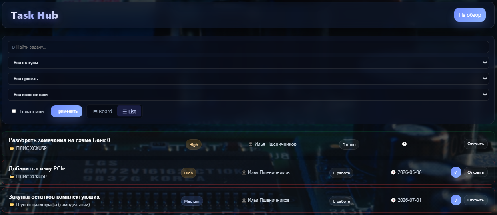
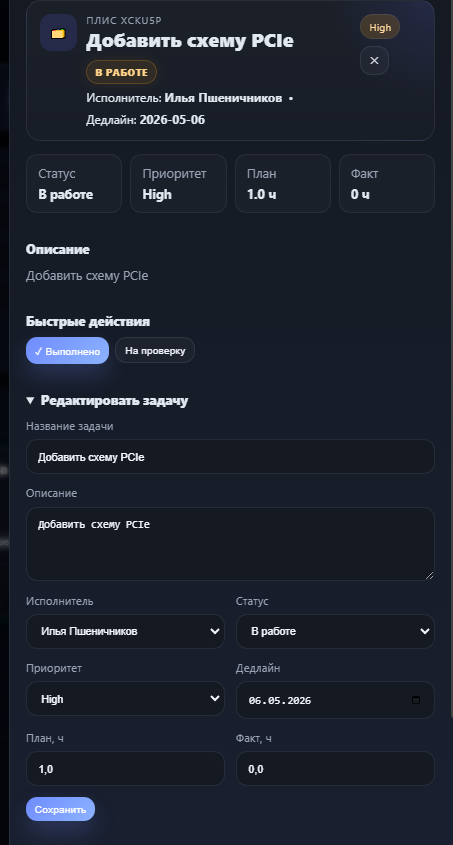

# Задачи

Раздел **Задачи** открывает рабочую область **Task Hub**, предназначенную для поиска, просмотра и управления рабочими задачами.

В Task Hub доступны два представления задач:

- **Board** — доска задач в формате Kanban;
- **List** — список задач.

По умолчанию открывается представление **Board**.

## Поиск и фильтрация задач

В верхней части Task Hub расположена строка поиска.

Для поиска задачи введите ее название или часть названия. Система отображает задачи, соответствующие введенному запросу.

Для дополнительной фильтрации можно использовать выпадающие списки:

- **Все статусы** — фильтрация по приоритету задачи: `High`, `Medium`, `Low`;
- **Все проекты** — фильтрация по проекту;
- **Все исполнители** — фильтрация по исполнителю.

Также доступен флажок **Только мои**, который позволяет отображать только задачи, назначенные текущему пользователю.

После выбора необходимых параметров нажмите **Применить**.

!!! note "Примечание"

    Если фильтры не заданы, Task Hub отображает общий список доступных задач.

## Представление List

В представлении **List** задачи отображаются в виде списка.

Для каждой задачи отображается основная информация:

- название задачи;
- проект;
- приоритет;
- исполнитель;
- статус;
- дата;
- кнопка **Открыть**.

Для поиска и фильтрации задач можно использовать строку поиска, выпадающие списки и флажок **Только мои**.

После выбора необходимых параметров нажмите **Применить**.

> Представление List в Task Hub.

Нажмите **Открыть**, чтобы перейти к подробному представлению задачи.

## Карточка задачи

После открытия задачи пользователь переходит к ее подробному представлению.

В этом представлении можно просмотреть и изменить параметры задачи.

> Подробное представление задачи.

## Представление Board

Для переключения из списка задач в Kanban-представление используйте переключатель **Board / List**.

В представлении **Board** задачи распределяются по этапам рабочего процесса:

- **Бэклог (To Do)**;
- **В работе**;
- **На проверке**;
- **Готово**.

> Представление Board в Task Hub.

Карточки задач можно перемещать между этапами рабочего процесса.

Это позволяет визуально отслеживать текущее состояние задач и их продвижение от постановки до завершения.

## Карточка задачи на доске

В представлении **Board** каждая задача отображается отдельной карточкой.

В карточке могут отображаться:

- название задачи;
- краткое описание;
- проект;
- исполнитель;
- дата;
- приоритет;
- текущий этап задачи.

Для работы с задачей также доступны действия:

- **Готово** — завершение задачи;
- **Проверка** — переход к этапу проверки;
- **Детали** — переход к подробному представлению и редактированию задачи.

## Работа с фильтрами в представлении Board

Фильтры в представлении **Board** работают так же, как и в представлении **List**.

Можно использовать:

- поиск по названию;
- фильтр по приоритету;
- фильтр по проекту;
- фильтр по исполнителю;
- флажок **Только мои**.

После выбора параметров нажмите **Применить**.

При этом изменяется только представление результатов: задачи отображаются не списком, а в соответствующих колонках Kanban-доски.

## Типовой сценарий работы

Чтобы найти необходимую задачу:

1. Откройте раздел **Задачи**.
2. В Task Hub введите название задачи в строку поиска или выберите необходимые фильтры.
3. При необходимости установите флажок **Только мои**.
4. Нажмите **Применить**.
5. Найдите нужную задачу в списке или на доске.
6. Нажмите **Открыть** или **Детали**, чтобы перейти к подробному представлению задачи.

## Представления задач

Переключатель **Board / List** позволяет выбрать удобный способ работы с задачами.

**List** подходит для последовательного просмотра задач и работы с их параметрами.

**Board** позволяет визуально отслеживать этапы выполнения задач и перемещать их между состояниями рабочего процесса.

!!! note "Примечание"

    Раздел **Доски** в меню навигации является отдельным разделом системы и не относится к переключателю **Board / List** в Task Hub. Раздел **Доски** предназначен для работы с чертежами.

## Следующие шаги

Для работы с чертежами перейдите в раздел [Доски](boards.md).

Для работы с проектными данными перейдите в раздел [Проекты](projects.md).

Для работы с файлами проекта используйте раздел [Repo](repository.md).
