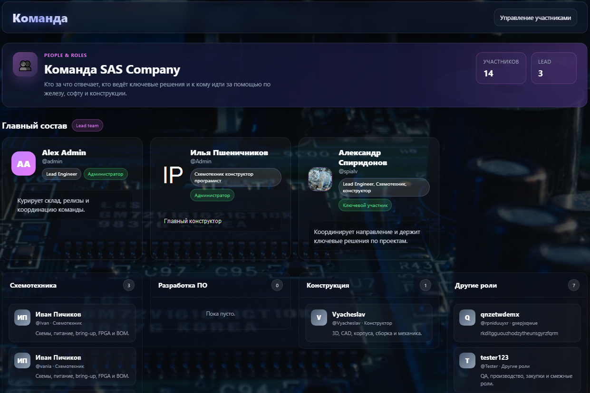

# Команда

Раздел **Команда** содержит информацию об участниках команды разработки и их областях ответственности.

Страница помогает понять, кто отвечает за ключевые направления проекта, к кому обращаться по вопросам программного обеспечения, конструкции и т. д.

> Раздел «Команда» с информацией об участниках и распределении ответственности.

## Общая информация

В верхней части страницы расположен блок **People & Roles**.

В блоке отображаются:

- название компании;
- краткое описание раздела;
- количество участников команды;
- количество руководителей направлений (**LEAD**).

Описание раздела содержит информацию о распределении ответственности между участниками команды и основных направлениях работы.

## Участники команды

Ниже расположены карточки участников команды, сгруппированные по направлениям деятельности.

Для каждого участника отображаются:

- аватар;
- ФИО;
- логин;
- должность или роль в команде;
- статус пользователя в системе;
- краткое описание области ответственности.

Такое представление позволяет быстро определить роль участника и понять, по каким вопросам к нему можно обратиться.

## Главный состав

В разделе **Главный состав** представлены участники, отвечающие за ключевые направления и принимающие основные технические решения.

Для каждого участника указаны его роль и область ответственности. 
Разделы: **Схемотехника**, **Разработка ПО** и **Конструкция** представлены для примера и могут быть иными в зависимости от проекта.

## Схемотехника

Раздел **Схемотехника** содержит участников, отвечающих за разработку и сопровождение электрических схем и связанную с ними предметную деятельность.

## Разработка ПО

Раздел **Разработка ПО** объединяет участников, занимающихся разработкой программного обеспечения.

В карточках участников указаны их роли и основные направления работы в проекте.

## Конструкция

Раздел **Конструкция** содержит участников, отвечающих за конструктивную часть разрабатываемых устройств и связанные с ней задачи.

## Другие роли

В разделе **Другие роли** представлены участники, чьи обязанности не относятся непосредственно к основным направлениям.

Распределение участников по ролям позволяет представить структуру команды и распределение ответственности в едином интерфейсе.

!!! note "Примечание" 
    Раздел **Команда** предназначен для ознакомления со структурой команды и распределением ролей. Наличие конкретных функций управления участниками зависит от прав пользователя в системе.
