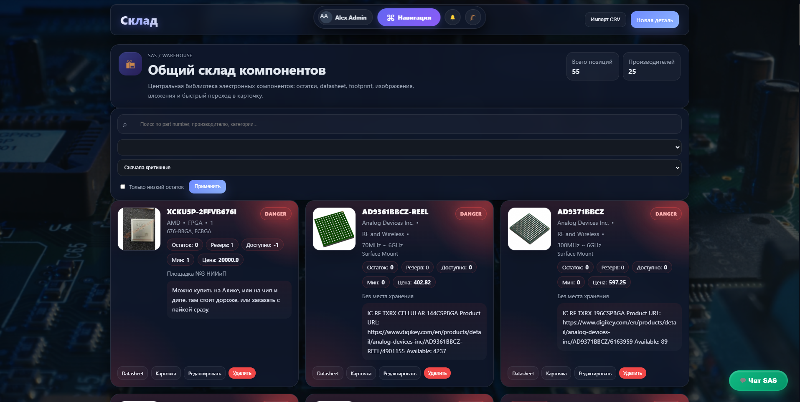

# Склад

Раздел **Склад** предназначен для учёта электронных компонентов, хранения информации об их характеристиках и просмотра сведений об использовании компонентов в проектах.

В разделе доступны следующие операции:

- поиск и фильтрация компонентов;
- просмотр краткой и подробной информации о деталях;
- создание новых деталей;
- импорт компонентов из CSV-файла, подготовленного в Altium;
- импорт данных по ссылке Digi-Key;
- просмотр и скачивание даташитов и 3D-моделей;
- просмотр проектов, в которых используется компонент.

## Просмотр элементной базы

На главной странице раздела отображается список компонентов в виде мини-карточек.

В карточках представлены основные сведения о компонентах:

- наименование и производитель;
- тип компонента;
- количество на складе;
- зарезервированное и доступное количество;
- минимальный остаток;
- цена;
- место хранения;
- заметки.

Цветовой индикатор показывает состояние запасов:

- **Зелёный (`success`)** — запас достаточный.
- **Жёлтый (`warning`)** — остаток низкий.
- **Красный (`danger`)** — компонент отсутствует на складе.

Для просмотра подробной информации нажмите на мини-карточку компонента или используйте кнопку **«Карточка»**.

## Поиск и фильтрация компонентов

Для поиска нужной детали можно использовать строку поиска и фильтры.

### Поиск

1. Откройте раздел **Склад**.
2. Введите в строку поиска наименование компонента или известные параметры.
3. При необходимости выберите производителя или категорию в соответствующем выпадающем списке.
4. Установите флажок **«Только низкий остаток»**, если требуется найти компоненты с низким запасом.
5. Нажмите **«Применить»**, чтобы применить выбранные условия.
6. Просмотрите полученный список компонентов.

### Комбинирование фильтров

Доступны следующие сочетания фильтров:

- производитель и низкий остаток;
- категория и низкий остаток.

Одновременно выбрать производителя и категорию нельзя.

## Карточка компонента

Подробная карточка содержит информацию о выбранном компоненте, включая характеристики, сведения о запасах, даташит, 3D-модель и информацию об использовании в проектах.

Чтобы открыть карточку, нажмите на мини-карточку компонента или кнопку **«Карточка»**.

В карточке доступны следующие возможности:

- просмотр характеристик компонента;
- просмотр даташита;
- открытие даташита в новой вкладке браузера;
- полноэкранный просмотр даташита на сайте;
- просмотр и скачивание 3D-модели;
- просмотр проектов, в которых используется компонент.

## Создание новой детали

Чтобы добавить компонент на склад, создайте новую деталь.

1. Откройте раздел **Склад**.
2. Нажмите кнопку **«Новая деталь»**.
3. В открывшейся в новой вкладке браузера форме заполните обязательные поля.
4. При необходимости добавьте даташит, внешнюю ссылку на даташит, изображение компонента и заметки.
5. Нажмите **«Сохранить»**.

### Обязательные поля

| Поле | Описание |
|---|---|
| Part Number | Обозначение или номер детали |
| Производитель | Производитель компонента |
| Категория | Категория компонента |
| Корпус | Тип корпуса компонента |
| Value | Значение или номинал компонента |
| Остаток | Количество компонентов на складе |
| Минимальный остаток | Минимальное количество компонентов, которое должно быть в наличии |
| Поставщик | Поставщик компонента |
| Цена за штуку | Стоимость одной единицы компонента в рублях |
| Место хранения | Место размещения компонента на складе |

### Необязательные поля

При необходимости можно добавить:

- даташит в формате PDF;
- внешнюю ссылку на даташит;
- изображение компонента;
- заметки.

После сохранения деталь появляется в списке склада в виде мини-карточки. Нажмите на неё, чтобы открыть подробную информацию.

### Импорт данных из Digi-Key

При создании детали можно использовать ссылку на страницу компонента в Digi-Key. Если соответствующая информация присутствует на сайте, система автоматически заполняет следующие поля:

- производитель;
- корпус;
- категория;
- поставщик;
- цена за штуку;
- даташит;
- изображение компонента;
- внешняя ссылка на даташит.

Чтобы импортировать данные:

1. Нажмите **«Новая деталь»**.
2. Найдите поле импорта Digi-Key в верхней части формы.
3. Вставьте ссылку на страницу компонента.
4. Нажмите кнопку **«Импортировать»** рядом с полем.
5. Проверьте заполненные данные и при необходимости внесите изменения.
6. Заполните остальные обязательные поля.
7. Нажмите **«Сохранить»**.

Импортированные данные зависят от информации, доступной на странице компонента Digi-Key.

## Импорт компонентов из CSV

Раздел поддерживает импорт данных из CSV-файла, подготовленного в Altium.

Чтобы открыть окно импорта:

1. Перейдите на главную страницу раздела **Склад**.
2. Нажмите кнопку **«Импорт CSV»** в верхней части страницы.
3. В открывшемся окне нажмите **«Выберите файл»**.
4. Укажите CSV-файл, подготовленный в Altium.
5. Нажмите синюю кнопку **«Импортировать»**, чтобы запустить импорт.

Чтобы закрыть окно без запуска импорта, нажмите чёрную кнопку **«Отмена»**.

## Просмотр даташита

Даташит — документ с техническими характеристиками компонента.

Если к компоненту прикреплён даташит в формате PDF, его можно открыть для просмотра непосредственно из карточки компонента.

Доступны два способа просмотра:

- открыть PDF в новой вкладке браузера;
- развернуть документ во весь экран на сайте с помощью кнопки **«Во весь экран»**.

### Скачивание даташита

Чтобы сохранить PDF-файл на компьютер:

1. Откройте даташит.
2. Щёлкните правой кнопкой мыши по документу.
3. Выберите пункт **«Сохранить как»**.
4. Укажите место сохранения файла.

## Просмотр и скачивание 3D-модели

В нижней части карточки компонента расположена область просмотра 3D-модели. Модель можно вращать в разных плоскостях.

Чтобы скачать модель:

1. Откройте карточку компонента.
2. Найдите чёрную кнопку **«Скачать»** над областью просмотра 3D-модели.
3. Нажмите кнопку.
4. Сохраните загруженный архив.

Архив с 3D-моделью предназначен для использования в САПР.

## Где используется компонент

В карточке компонента предусмотрено поле **«Где используется»**.

В нём отображается список проектов, в которых используется выбранная деталь. Это позволяет определить, с какими проектами связан компонент.

## Следующие шаги

- [Библиотека компонентов](library.md) — работа с библиотекой материалов.
- [Проекты](projects.md) — работа с проектами и связанными с ними инженерными данными.