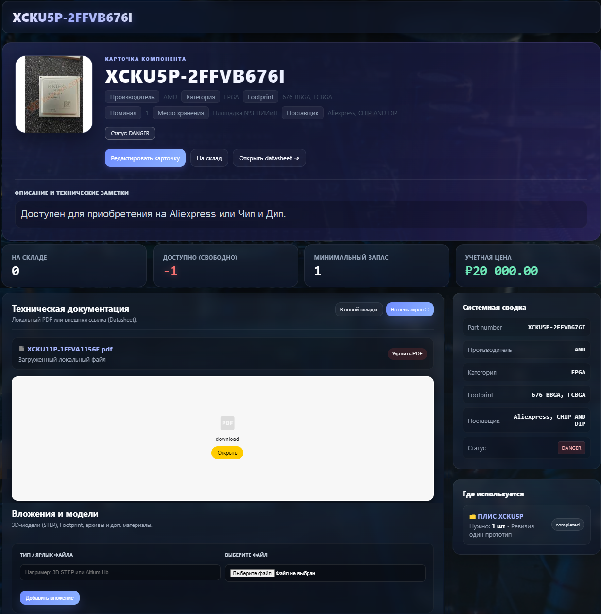
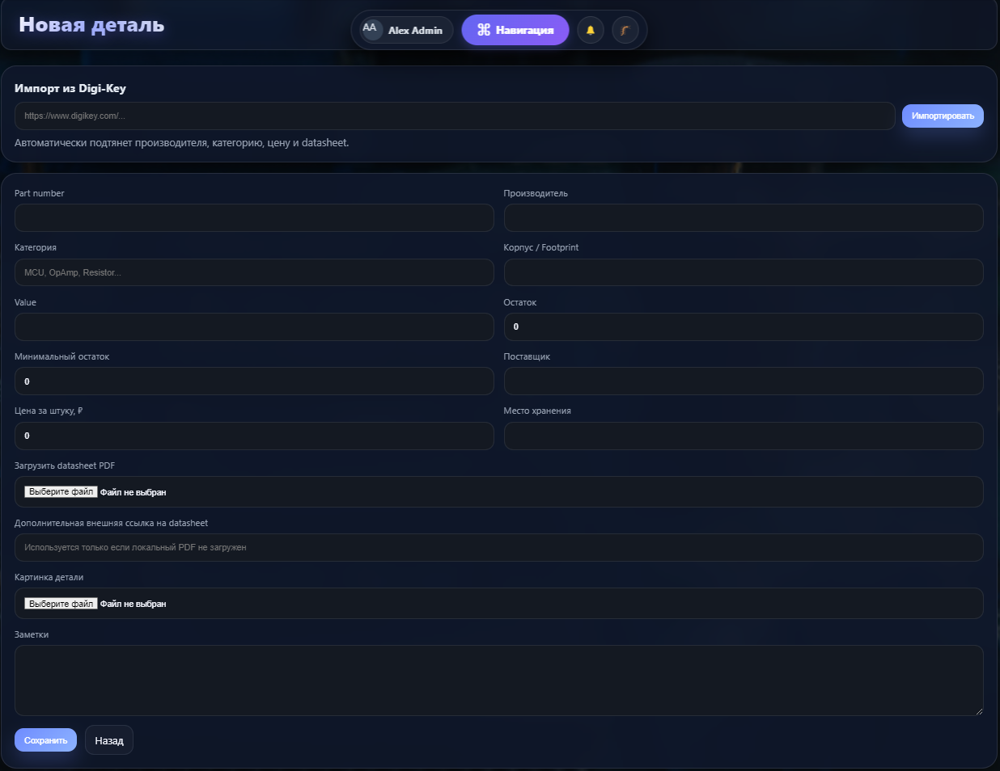

# Склад

Раздел **Склад** предназначен для работы с элементной базой и связанными с ней инженерными данными.

В разделе можно просматривать доступные компоненты, находить необходимые элементы с помощью поиска и фильтров, а также открывать подробную информацию о выбранном компоненте.

## Просмотр элементной базы

На главной странице раздела отображается список доступных компонентов.

Для поиска необходимого элемента можно использовать:

- строку поиска;
- фильтры;
- карточки компонентов.

> Главная страница раздела «Склад».

## Поиск компонента

Чтобы найти необходимый компонент:

1. Откройте раздел **Склад**.
2. Введите название или другие известные параметры компонента в строку поиска.
3. При необходимости используйте доступные фильтры.
4. Выберите нужный компонент из списка.

Использование поиска и фильтров позволяет сократить количество отображаемых элементов и быстрее найти нужную позицию.

## Карточка компонента

Для просмотра подробной информации выберите компонент в списке.

В карточке компонента может отображаться информация об элементе и связанные с ним данные.

> Карточка компонента.

В карточке доступны связанные материалы и сведения о компоненте, включая:

- 3D-модель;
- Datasheet;
- информацию об использовании компонента.

## 3D-модель

При наличии 3D-модели она доступна из карточки компонента.

3D-представление позволяет визуально ознакомиться с компонентом и его геометрией.

## Datasheet

Если для компонента доступен Datasheet в формате PDF, его можно открыть из карточки.

Datasheet содержит технические характеристики и параметры элемента, предоставленные для соответствующего компонента.

## Где используется

Карточка компонента может содержать информацию о проектах и других объектах системы, в которых используется выбранный элемент.

Это позволяет определить взаимосвязи между элементной базой и проектами.

## Создание новой детали (компонента)

Для создания нового компонента используйте соответствующую функцию раздела **Склад**.

> Форма создания новой детали (компонента).

Заполните необходимые поля и сохраните деталь, нажав кнопку «Сохранить».

После создания новый компонент становится доступным в элементной базе.

## Следующие шаги

Для работы с файлами и материалами, связанными с проектами, перейдите в раздел [Библиотека](library.md).

Для использования компонентов в составе проекта см. раздел [Проекты](projects.md).
